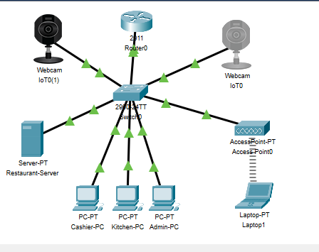

# MazajChef — Smart & Secure Restaurant Network

A Cisco Packet Tracer simulation of a segmented restaurant network, designed to separate business operations from guest wireless traffic while supporting internal connectivity and basic network services.

> **Scope:** Educational network simulation built in Cisco Packet Tracer 9.0.1. The restaurant portal is a static HTTP page, not a production POS application. External Internet connectivity, NAT, and public DNS have not been implemented or demonstrated.

## Network topology

The topology uses a Cisco 2911 router, a Cisco 2960 switch, PCs for the cashier, kitchen, and administration, a restaurant server, two simulated IP cameras, and a guest wireless access point connected to a laptop.

## Network design

The switch uplink (`GigabitEthernet0/1`) connects to Router0 (`GigabitEthernet0/0`) using an IEEE 802.1Q trunk. Router-on-a-Stick subinterfaces provide IPv4 gateways for six VLANs.

| VLAN | Name | Subnet | Router gateway | Switch access port(s) | Connected device(s) |
|---|---|---|---|---|---|
| 10 | CASHIER | `192.168.10.0/24` | `192.168.10.1` | `Fa0/1` | Cashier-PC — `192.168.10.10` |
| 20 | KITCHEN | `192.168.20.0/24` | `192.168.20.1` | `Fa0/2` | Kitchen-PC — `192.168.20.20` |
| 30 | ADMIN | `192.168.30.0/24` | `192.168.30.1` | `Fa0/3` | Admin-PC — `192.168.30.30` |
| 40 | SERVER | `192.168.40.0/24` | `192.168.40.1` | `Fa0/4` | Restaurant-Server — `192.168.40.40` |
| 50 | CCTV | `192.168.50.0/24` | `192.168.50.1` | `Fa0/5`, `Fa0/6` | Simulated cameras — `192.168.50.10`, `192.168.50.11` |
| 60 | GUESTS | `192.168.60.0/24` | `192.168.60.1` | `Fa0/7` | Access Point0 and Laptop1 (DHCP) |

All listed networks use a `/24` mask (`255.255.255.0`). The wireless SSID is `MazajChef-Guest`, with WPA2-PSK/AES configured in the simulation. The Wi-Fi passphrase is intentionally not published.

## Features

- **VLAN segmentation:** Separate logical networks for cashier, kitchen, administration, server, CCTV, and guests.
- **Router-on-a-Stick:** Inter-VLAN routing over a single IEEE 802.1Q trunk.
- **Guest DHCP:** Router0 serves the `GUESTS` pool on `192.168.60.0/24`; `192.168.60.1` through `192.168.60.10` are excluded. A guest laptop was assigned `192.168.60.11/24` with gateway `192.168.60.1`.
- **Guest isolation ACL:** The named extended ACL `GUEST_ISOLATION`, applied inbound on `GigabitEthernet0/0.60`, denies guest-sourced IPv4 traffic to VLANs 10–50. Other IPv4 traffic is permitted by the final ACL rule; this does not imply working Internet access.
- **Internal HTTP portal:** A static MazajChef page hosted at `http://192.168.40.40`, listing the correct local device addresses.
- **Simulated CCTV:** Two cameras in VLAN 50, reachable during the documented administration-network tests.

## Verified tests

These results come from Packet Tracer CLI output and screenshots recorded during project development. They describe the indicated tests, not a blanket guarantee of all network behavior.

| Test | Observed result |
|---|---|
| Kitchen-PC → kitchen gateway `192.168.20.1` | 4/4 ICMP replies |
| Admin-PC → admin gateway `192.168.30.1` | 4/4 ICMP replies |
| Restaurant-Server → server gateway `192.168.40.1` | 4/4 ICMP replies |
| Kitchen-PC → Restaurant-Server `192.168.40.40` | 4/4 ICMP replies; HTTP portal opened |
| Cashier-PC → Restaurant-Server `192.168.40.40` | 4/4 ICMP replies; HTTP portal opened |
| Admin-PC → camera `192.168.50.10` | Initial 3/4, then 4/4 replies |
| Admin-PC → camera `192.168.50.11` | Initial short runs 3/4; later 10/10 replies |
| Laptop1 → guest gateway `192.168.60.1` | 4/4 replies after DHCP assignment; also 4/4 after ACL |
| Guest Laptop1 → Admin-PC **before ACL** | 10/10 replies (unrestricted access demonstrated) |
| Guest Laptop1 → Admin-PC **after ACL** | 0/10 replies; router returned `Destination host unreachable` |
| Guest Laptop1 → Restaurant-Server **after ACL** | 0/4 replies |
| Guest Laptop1 → Cashier-PC **after ACL** | 0/4 replies |
| Guest Laptop1 → Kitchen-PC **after ACL** | 0/4 replies |
| Guest Laptop1 → camera `192.168.50.10` **after ACL** | 0/4 replies |
| Guest Laptop1 DHCP following ACL | User confirmed successful DHCP request; screenshot/lease logs can be added for formal evidence |

### About the first-packet CCTV timeouts

Short initial pings to both cameras sometimes timed out on the first packet. Later attempts succeeded, including a 10-packet test to the second camera with zero packet loss. A Packet Tracer Simulation Mode trace demonstrated ARP resolution for the administration gateway, temporary ICMP buffering, subsequent packet forwarding through the router, and a returned ICMP Echo Reply. **That trace does not conclusively establish the cause of the earlier timeouts**. The initial failures are retained here for accuracy rather than hidden.

## How to explore the simulation

1. Install Cisco Packet Tracer (the project was built with version 9.0.1).
2. Open [`MazajChef-Secure-Network.pkt`](MazajChef-Secure-Network.pkt).
3. Use **Realtime** mode for connectivity tests or **Simulation** mode to inspect ARP and ICMP packet flow.
4. On Cashier-PC or Kitchen-PC, visit `http://192.168.40.40` in the simulated Web Browser.
5. On Laptop1, confirm the `Wireless0` DHCP settings, then test the guest gateway and protected internal destinations.

## Limitations and security notes

- This is a **Packet Tracer demonstration**, not a production-ready restaurant installation.
- No ISP uplink, NAT configuration, or operational external Internet service was verified.
- DNS server configuration is not part of the demonstrated functionality; IP-based tests do not require DNS.
- The guest ACL is a basic IPv4 subnet policy, not a complete firewall, intrusion prevention system, or comprehensive production security design. In particular, `permit ip any any` allows traffic that does not match the preceding denials.
- Guest isolation was verified with ICMP tests across the five internal VLANs. Camera streaming and real POS transaction processing were not demonstrated.
- Device and security settings should be reassessed before any real deployment.

## Project context

Developed as a **Computer Networks** course project at **Taif University** by a five-member student team. The associated academic report and presentation document the design rationale, implementation, test evidence, discussion, and limitations.
